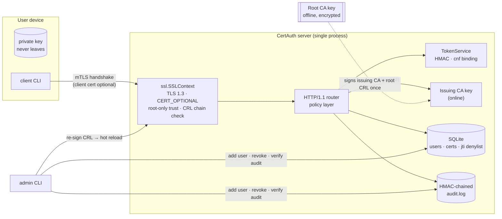
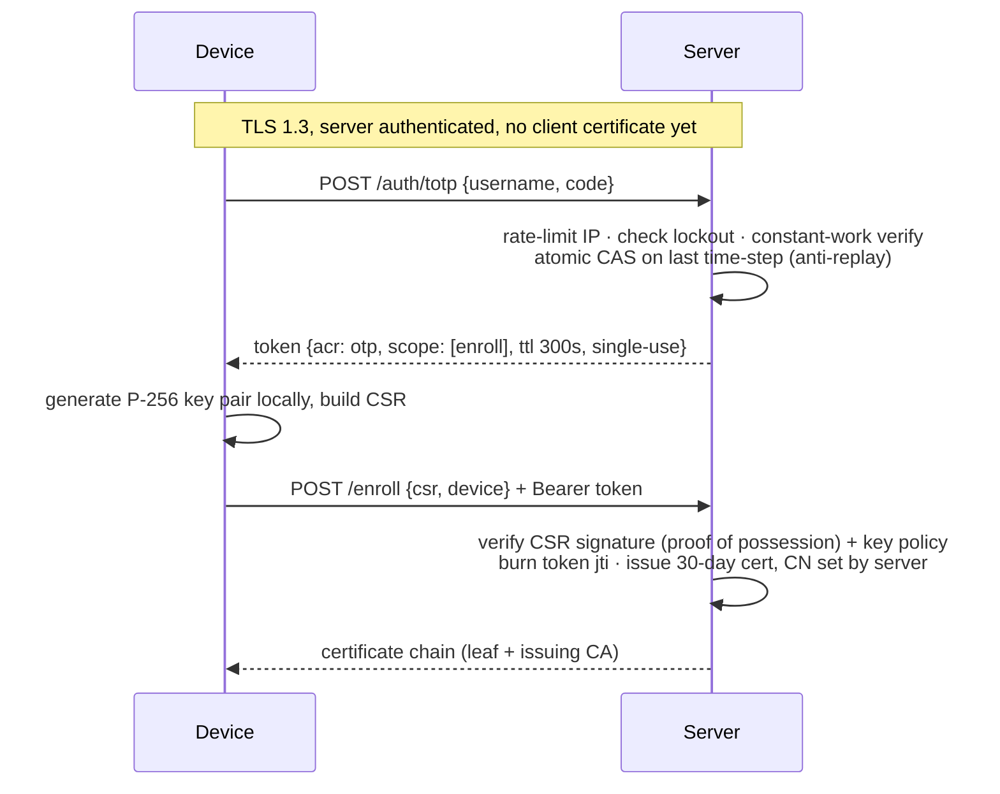
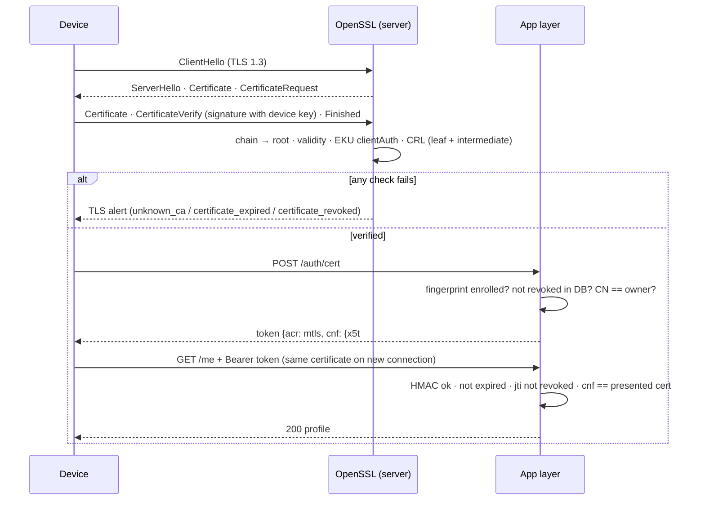

# CertAuth — Certificate-Based Passwordless Login over Manual mTLS, with TOTP Fallback

A from-scratch authentication system in which **the TLS 1.3 handshake itself is the
login**. Users never type a password: each device holds a private key generated
locally, and proves possession of it during a mutually-authenticated TLS handshake.
A time-based one-time password (RFC 6238) serves only as a **fallback** — to enroll a
first device or recover after losing one — and grants a deliberately weak,
single-use session that can do nothing except request a device certificate.

No web framework, no reverse proxy, no TLS terminator: the server builds its own
`ssl.SSLContext`, performs the handshake on raw sockets and parses HTTP/1.1 itself, so
every trust decision is explicit and auditable in [`certauth/server.py`](certauth/server.py).

```
60 tests passing · 0 framework dependencies · TLS 1.3 only · ~1,600 lines of Python + 600 lines of tests
```

---

## Highlights

| Area | What is implemented |
|---|---|
| **PKI** | Two-tier hierarchy: offline P-384 root (passphrase-encrypted key, `pathLen=1`) → online issuing CA (`pathLen=0`, EKU-constrained) → server + client leaves. Full RFC 5280 profile: critical BasicConstraints / KeyUsage, EKU, SKI/AKI, SAN, CRL Distribution Points. |
| **Manual mTLS** | TLS 1.3 only, `CERT_OPTIONAL` client auth, trust anchor = private root only, `VERIFY_X509_STRICT` + `VERIFY_CRL_CHECK_CHAIN`, no session tickets / compression / renegotiation. |
| **Two-layer cert validation** | OpenSSL validates chain, validity, purpose and revocation **during the handshake**; the app layer then requires the certificate to be *enrolled* (SHA-256 fingerprint known), unrevoked, and owned by its CN. |
| **Live revocation** | Revoking a device re-signs the CRL; the server detects the new file and hot-swaps its `SSLContext`, so the next handshake fails with TLS alert `certificate_revoked` — no restart. |
| **Enrollment** | Device keys (P-256, P-384, Ed25519, RSA ≥ 3072) are generated client-side; only a CSR is sent. Proof-of-possession is checked; identity fields in the CSR are **ignored** and set by the server. Certificates are short-lived (30 days). |
| **TOTP from first principles** | HOTP/TOTP implemented per RFC 4226/6238 and verified against the RFCs' own test vectors (SHA-1/256/512) plus an independent library. Constant-work verification, ±1 step drift window. |
| **TOTP hardening** | Atomic compare-and-set replay guard (proved with a 10-thread race test), per-user lockout with exponential backoff, per-IP token-bucket rate limit, constant-shape errors (no user enumeration). |
| **Proof-of-possession tokens** | Tokens issued after mTLS carry `cnf.x5t#S256` (RFC 8705). They are only accepted on a connection presenting the *same* certificate — a stolen token is useless. |
| **Assurance levels / step-up** | mTLS → `acr=mtls`, scopes `profile devices enroll`, 15 min. TOTP → `acr=otp`, scope `enroll` only, 5 min, **single-use**. |
| **Secrets at rest** | One 256-bit master key; HKDF-SHA256 derives independent keys per purpose. TOTP seeds sealed with AES-256-GCM using the **username as AAD**, defeating row-swap attacks. |
| **Tamper-evident audit** | HMAC-chained JSON-lines log, safe across processes (`flock`). Any edit, deletion, insertion or reordering is detected by `admin verify-audit`. |

---

## Architecture



### Flow 1 — first-time enrollment (TOTP fallback)



### Flow 2 — passwordless login (every time after)



---

## Quick start

Requirements: Python ≥ 3.10 (3.13+ also reports the verified chain). Works on
Windows, macOS and Linux. **VS Code users: see [VSCODE.md](VSCODE.md)** — run/debug
configurations, tasks and Test Explorer are preconfigured in `.vscode/`.

```bash
pip install -r requirements.txt

python web_demo.py   # browser demo for presentations: http://127.0.0.1:8080
python demo.py       # same story in the terminal (any OS); ./demo.sh on Linux/macOS
python -m pytest     # 60 tests
```

### Browser demo (for presentations)

`python web_demo.py` starts the real mTLS server in the background and opens a page
that plays ten scenes against it: set-up, enrollment with TOTP, passwordless login,
and five attacks (code replay, stolen login pass, fake CA, stolen laptop + revocation,
audit-log tampering), plus recovery with a new device. Each request is drawn moving
through the server's "gates" (TLS handshake check, device register, code check), and
every tick, verdict and audit-log line comes from the running server, not a script.
Use the arrow keys or the *Next scene* button to move between scenes. The page shows
the current TOTP code as a stand-in for Alice's phone, or you can scan its QR code
with a real authenticator app. Both servers listen on 127.0.0.1 only.

Manual use:

```bash
export CERTAUTH_DATA=./data CERTAUTH_CA=./data/pki/root-ca.crt
python3 -m certauth.admin init                     # asks for a root-key passphrase
python3 -m certauth.admin add-user alice           # prints QR — scan with any authenticator app
python3 -m certauth.admin serve &                  # https://localhost:8443

python3 -m certauth.client enroll --user alice --device laptop   # prompts for TOTP once
python3 -m certauth.client me                      # passwordless from now on
python3 -m certauth.client devices
python3 -m certauth.client revoke <serial>
python3 -m certauth.admin verify-audit
```

Set `CERTAUTH_KEY_PASSPHRASE` to have the client encrypt its device key at rest.

## API

| Method | Path | Auth | Purpose |
|---|---|---|---|
| GET | `/health` | — | liveness + negotiated TLS parameters |
| GET | `/pki/ca`, `/pki/crl` | — | root certificate (PEM), issuing-CA CRL (DER) |
| POST | `/auth/cert` | client certificate | passwordless login → cert-bound token |
| POST | `/auth/totp` | `{username, code}` | fallback → single-use `enroll` token |
| POST | `/enroll` | token w/ `enroll` | CSR → device certificate |
| GET | `/me` | cert-bound token | profile + certificate + verified chain |
| GET | `/devices` | cert-bound token | list own devices |
| POST | `/devices/revoke` | cert-bound token, `acr=mtls` | revoke own device, CRL re-published live |
| POST | `/logout` | any token | add `jti` to denylist |

## Test suite (attack-driven)

| Category | Scenarios verified |
|---|---|
| Standards conformance | RFC 6238 Appendix B vectors (SHA-1/256/512), RFC 4226 Appendix D vectors, cross-check with `pyotp`, chain validated by an **independent** RFC 5280 path validator (`cryptography.x509.verification`) |
| Certificate attacks | rogue CA minting `CN=alice`; expired certificate; genuine cert with wrong EKU; validly-signed but un-enrolled cert; stolen certificate without its private key; CSR requesting `CN=admin`; weak RSA-2048 / secp256k1 keys; forged CSR signature |
| Revocation | API revocation → next handshake fails with `certificate revoked`; serial present in published CRL; users cannot revoke others' devices; device cap |
| TOTP attacks | replay; **10-way concurrent replay race → exactly one success**; brute force → lockout → backoff expiry; user enumeration; per-IP rate limit; single-use enroll token |
| Token attacks | signature tampering; expiry; logout/denylist; stolen cert-bound token used with no cert and with the attacker's own valid cert; scope escalation (TOTP token → `/me` = 403) |
| Transport | TLS 1.2 downgrade refused; client rejects server not chaining to the private root; oversized / malformed HTTP |
| Integrity | audit chain intact after a full flow; modification, deletion, reordering and keyless forgery all detected; TOTP seed ciphertext swapped between users fails to decrypt |

Two real bugs were found by this suite during development — a cross-process audit-chain
fork (admin CLI and server appending concurrently) and unsynchronised SQLite reads under
the concurrent replay race. Both are fixed and now covered by tests.

## Project layout

```
certauth/
  pki.py        CA hierarchy, CSR validation, client issuance, CRLs
  server.py     manual TLS 1.3 server, HTTP parser, policy, endpoints
  totp.py       RFC 4226 / 6238 implementation
  tokens.py     HMAC tokens with RFC 8705 certificate binding
  store.py      SQLite: users, devices, token denylist (atomic CAS)
  crypto.py     master key, HKDF sub-keys, AES-256-GCM box
  audit.py      HMAC-chained, flock-protected audit log
  client.py     client library + CLI
  admin.py      offline/admin CLI
tests/          60 unit + end-to-end attack tests
docs/SECURITY.md  threat model, design rationale, limitations
demo.py         cross-platform scripted demonstration (demo.sh: bash version)
.vscode/        launch / tasks / test settings for VS Code
```

## Standards referenced

RFC 8446 (TLS 1.3) · RFC 5280 (X.509 PKI & CRLs) · RFC 2986 (PKCS #10 CSR) ·
RFC 4226 (HOTP) · RFC 6238 (TOTP) · RFC 8705 (certificate-bound tokens) ·
RFC 8176 (AMR values) · RFC 5869 (HKDF) · NIST SP 800-63B (authenticator assurance) ·
NIST SP 800-57 (key management).
